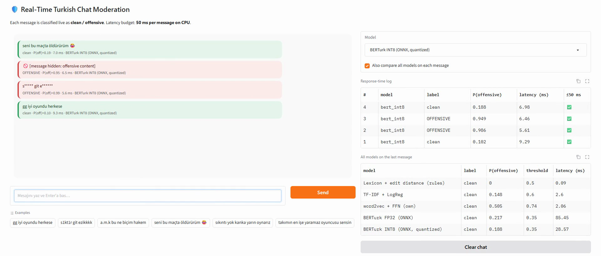
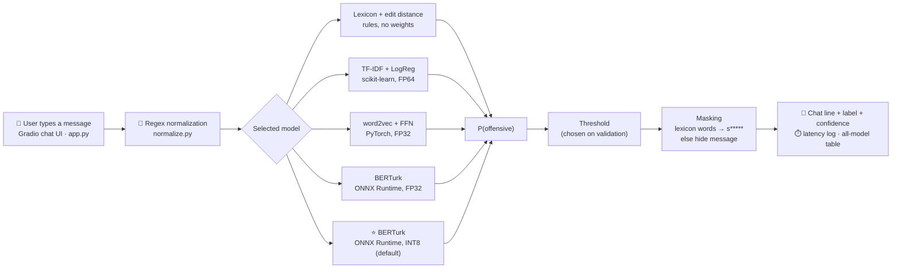

# 🛡️ Real-Time Turkish Chat Moderation

**SWE015 – Introduction to Large Language Models · Homework, Use Case 4**
Akif Kul · 220901590

A chat application that labels every Turkish message as **clean** or **offensive** the moment it is
sent, masks the offensive words, and does it on a **laptop CPU in about 10 ms per message**.
The model behind it is **BERTurk, fine-tuned on OffensEval-TR 2020 and quantized to INT8**.

| | |
|---|---|
| 🎥 **Demo video (2 min)** | https://drive.google.com/file/d/1EwK2Mm5Jr0UVTSTYXPAr6FbwNsmDo5yj/view |
| 🤗 **Quantized model (ONNX FP32 + INT8)** | [akifkulll/berturk-offenseval-tr-onnx](https://huggingface.co/akifkulll/berturk-offenseval-tr-onnx) |
| 🤗 **Fine-tuned PyTorch checkpoint** | [akifkulll/berturk-offenseval-tr](https://huggingface.co/akifkulll/berturk-offenseval-tr) |
| 📊 **Full results** | [`results/results.md`](results/results.md) · [`results/results.json`](results/results.json) |



---

## Contents

1. [The problem](#1-the-problem)
2. [Results at a glance](#2-results-at-a-glance)
3. [How it works: architecture](#3-how-it-works-architecture)
4. [The data](#4-the-data)
5. [Preprocessing: cleaning noisy chat text](#5-preprocessing-cleaning-noisy-chat-text)
6. [The five models](#6-the-five-models)
7. [Quantization: from FP32 to INT8](#7-quantization-from-fp32-to-int8)
8. [How the numbers were measured](#8-how-the-numbers-were-measured)
9. [What the comparison showed](#9-what-the-comparison-showed)
10. [Limitations and failure cases](#10-limitations-and-failure-cases)
11. [Setup and run](#11-setup-and-run)
12. [Reproduce everything](#12-reproduce-everything)
13. [Project structure](#13-project-structure)
14. [Technique map](#14-technique-map)
15. [Sources and AI usage](#15-sources-and-ai-usage)

---

## 1. The problem

A gaming platform wants every chat message checked **before other players see it**. Two things make
this hard:

- **The text is noisy.** Players write `s1kt1r` (numbers instead of letters), `amkkkk` (stretched
  letters), `a.m.k` (dotted letters), `o*ç` (masked letters) and often skip Turkish characters.
- **There is no GPU.** The moderation server is CPU-only, so every message has a time limit.

**What success looks like (set before building):**

| Goal | Target | Result |
|---|---|---|
| Quality | Macro-F1 on the official test set (classes are imbalanced, ~20% offensive) | **0.810** with the INT8 model |
| Speed | **p95 latency ≤ 50 ms per message** on a laptop CPU | **18.1 ms** p95, 10.1 ms mean ✅ |
| Product | Live label + confidence, masking, latency log, model switch | ✅ all in the app |

---

## 2. Results at a glance

All five models were scored on the **same official test set (3,528 tweets)**, one message at a time,
on the same laptop CPU (Intel Core i5-12500H, Windows 11, no GPU).

| Model | Macro-F1 | Offensive recall | Size (MB) | Latency mean (ms) | Latency p95 (ms) | p95 ≤ 50 ms |
|---|---:|---:|---:|---:|---:|:---:|
| Lexicon + edit distance (rules) | 0.6669 | 0.3324 | 0.001 | 3.67 | 10.00 | ✅ |
| TF-IDF + logistic regression | 0.7715 | 0.5698 | 2.0 | 1.44 | 1.92 | ✅ |
| word2vec + feed-forward net (own) | 0.6843 | 0.4721 | 11.5 | 0.17 | 0.30 | ✅ |
| BERTurk FP32 (ONNX Runtime) | 0.8116 | 0.6997 | 423.0 | 19.13 | 34.75 | ✅ |
| **BERTurk INT8 (ONNX Runtime) — used in the app** | **0.8102** | **0.6872** | **106.8** | **10.09** | **18.08** | ✅ |

**In one sentence:** INT8 quantization made BERTurk **4× smaller and ~1.9× faster** while losing only
**0.0014 macro-F1**, and it stays far inside the 50 ms budget.

> *Offensive recall* = the share of truly offensive messages that the model catches.
> *p95* = 95% of messages were processed faster than this.

---

## 3. How it works: architecture



**Step by step, for one message:**

1. **Input.** You type into the Gradio chat (`app.py`).
2. **Preprocessing.** `src/normalize.py` fixes noisy spelling (see [section 5](#5-preprocessing-cleaning-noisy-chat-text)).
   BERTurk additionally uses its own **WordPiece** tokenizer.
3. **Model.** The selected model returns **P(offensive)**, a number between 0 and 1.
   The default is the **INT8 BERTurk**.
4. **Decision.** If P(offensive) ≥ the model's threshold, the message is **OFFENSIVE**.
   Each model's threshold was chosen on the validation set (TF-IDF 0.60, FFN 0.74, BERTurk 0.35).
5. **Masking.** Offensive words found in the lexicon are masked (`siktir` → `s*****`).
   If the model flags a message but no lexicon word is in it (an insult without swear words),
   the **whole message is hidden**.
6. **Output.** The chat shows the (masked) message, label, confidence and latency. The side panel
   logs every message's latency against the 50 ms budget and can compare all five models.

**Where everything runs**

| Part | Where |
|---|---|
| App + all five models at inference time | Laptop CPU (no GPU). All models load **and warm up** at start-up. |
| BERTurk fine-tuning | Google Colab, NVIDIA A100 (about 2.5 minutes) |
| ONNX export + INT8 quantization | Colab, then uploaded to the Hugging Face Hub |
| Lexicon, TF-IDF, word2vec + FFN training | Laptop CPU (about 3 minutes in total) |

---

## 4. The data

**OffensEval-TR 2020** (Çöltekin, 2020): Turkish tweets labeled **NOT** (clean) or **OFF** (offensive).
`src/data.py` downloads it automatically.

| Split | Messages | Offensive | Comes from |
|---|---:|---:|---|
| Train | 28,601 | 19.3% | official training file (90%) |
| Validation | 3,155 | 19.7% | official training file (10%) |
| **Test** | **3,528** | **20.3%** | **official test set with gold labels** |

- The validation split is chosen by an **MD5 hash of the tweet id**, so it is identical on every
  machine and every library version (no random seed involved).
- The validation set is used only to pick hyper-parameters and decision thresholds.
  **The test set is used once, for the final table.**
- Classes are imbalanced (about 1 offensive message in 5), so the main metric is **macro-F1**
  (the average of the F1 scores of both classes) rather than accuracy.

---

## 5. Preprocessing: cleaning noisy chat text

`src/normalize.py` uses regular expressions to undo the tricks players use:

| Raw message | After normalization | What happened |
|---|---|---|
| `s1kt1r git EZİKKKK` | `siktir git ezik` | leetspeak (`1`→`i`), stretched letters, lower-case |
| `a.m.k bu ne biçim maç` | `amk bu ne bicim mac` | dotted letters glued back, Turkish letters folded |
| `o*ç hakem` | `oc hakem` | masking character removed |
| `s i k t i r` | `siktir` | spaced-out letters joined |
| `2020'de 5 gol attı` | `2020 de 5 gol atti` | numbers are **not** turned into letters |
| `@USER https://… ŞEREFSİZ` | `serefsiz` | mentions and links removed |

There are **two output versions**:

- **`for_bert`**: a light clean-up. It keeps upper/lower case and Turkish letters, because BERTurk is
  a *cased* model and learned from real Turkish text.
- **`for_classic`**: aggressive. Lower-case, Turkish letters folded to ASCII (`ş`→`s`, `ı`→`i`),
  split into tokens. Used by the lexicon, TF-IDF and word2vec.

---

## 6. The five models

The homework asks for a *model ladder*: classical baseline → neural network → Transformer →
quantized Transformer. This project has five steps.

### 6.1 Lexicon + minimum edit distance (rule baseline)

- **76 hand-collected offensive roots** in [`data/lexicon_tr.txt`](data/lexicon_tr.txt).
- A word is offensive if it
  - matches a root **exactly** (short roots like `amk`, `aq`),
  - **starts with** a root (catches Turkish suffixes: `orospunun`, `salaklar`),
  - is **one edit away** from a root of 6+ letters, using **Levenshtein distance** (catches typos: `orosbu`, `serefsz`),
  - or is the root with **1–2 letters deleted** (catches vowel-dropped spellings: `sktr`).
- An **allow-list** of 10 entries stops innocent words that look like swear words after Turkish letters
  are removed: `sıkıntı` → `sikinti`, `şikayet` → `sikayet`.
- No training and no weights.

### 6.2 TF-IDF + logistic regression (classical baseline)

- Features: **word 1–2-grams** + **character 2–5-grams**. Character n-grams help with Turkish suffixes
  and misspellings.
- Class-balanced logistic regression. `C` chosen from {0.5, 1, 2, 4, 8} on validation → **C = 2**.

### 6.3 Own word2vec + feed-forward network (neural network)

1. **word2vec trained from scratch** on the training tweets: skip-gram with negative sampling,
   vocabulary 29,043 words, 100 dimensions, window 5, 10 epochs.
2. Each message becomes the **average of its word vectors**.
3. A **feed-forward network** (100 → 256 → 2, ReLU, dropout 0.3) is trained with **SGD and
   backpropagation** (learning rate 0.01, momentum 0.9, class-weighted loss). The best of 60 epochs
   on validation is kept (epoch 10).

### 6.4 BERTurk (Transformer)

- `dbmdz/bert-base-turkish-cased` with a **classification head**, max 128 tokens.
- AdamW, learning rate 2e-5, batch 32, linear warm-up, bf16, 3 epochs on a Colab A100.

| Epoch | Train loss | Validation macro-F1 |
|---:|---:|---:|
| 1 | 0.336 | 0.820 |
| **2** | **0.210** | **0.831** ← kept |
| 3 | 0.134 | 0.831 |

The training loss keeps falling in epoch 3 while validation stops improving: the start of
overfitting, so the epoch-2 checkpoint is kept. The full log is saved in
[`notebooks/train_berturk_colab.ipynb`](notebooks/train_berturk_colab.ipynb).

### 6.5 BERTurk INT8 (quantized Transformer)

The same weights, exported to ONNX and quantized. No retraining. See the next section.

---

## 7. Quantization: from FP32 to INT8

`src/export_onnx.py` does three things:

1. **Export** the fine-tuned BERTurk to **ONNX** with PyTorch's `torch.export`-based exporter.
   A check confirms that ONNX and PyTorch give the **same probabilities** (to 3 decimal places).
2. **Quantize** with **ONNX Runtime dynamic quantization**: weights are stored as 8-bit integers;
   activations are quantized on the fly for each input. No calibration data and no retraining.
3. **Check** that the INT8 file is really smaller and score both versions on the test set.

| | FP32 | INT8 | Change |
|---|---:|---:|---|
| Size | 423.0 MB | 106.8 MB | **4.0× smaller** |
| Latency (mean) | 19.13 ms | 10.09 ms | **1.9× faster** |
| Latency (p95) | 34.75 ms | 18.08 ms | 1.9× faster |
| Macro-F1 | 0.8116 | 0.8102 | −0.0014 |

**Why it works:** most of BERT's computation is matrix multiplication. With 8-bit weights, the file
is a quarter of the size and the CPU can use fast integer instructions, while the decision
(offensive or not) almost never changes.

---

## 8. How the numbers were measured

`python -m src.benchmark` produces the results table:

- **Same test set** for every model: all 3,528 official test messages.
- **One message at a time** (batch size 1), like a real chat. Latency **includes preprocessing**.
- **20 warm-up messages** first, because ONNX Runtime and PyTorch are slow on their very first calls.
- Latency is reported as **mean** and **p95** over all 3,528 messages (the homework asks for ≥ 100).
- Hardware is detected and written into the results: Intel Core i5-12500H, 16 logical cores,
  Windows 11, CPU only.
- Every misclassified test message is saved to `results/errors_<model>.csv` for error analysis.

> Latencies shown live in the app vary from message to message (CPU frequency, other programs).
> The table is the reliable number because it averages 3,528 messages.

---

## 9. What the comparison showed

| Model | Where it wins | Where it loses |
|---|---|---|
| **Lexicon** | Fast, fully explainable, no training data needed | Finds only **33%** of offensive messages: insults without swear words slip through |
| **TF-IDF** | The best cheap model: **0.77** macro-F1 in **1.4 ms** and 2 MB | Cannot understand context or word order |
| **word2vec + FFN** | Tiny and the fastest (0.17 ms) | Below TF-IDF (**0.68**): 28,601 tweets are too few to learn good word vectors, and averaging the vectors throws away word order |
| **BERTurk INT8** | Best quality (**0.81**, recall 0.69) and still far under the budget (p95 18 ms, 2.8× headroom) | 107 MB, about 7× slower than TF-IDF |

**The trade-off:** moving from TF-IDF to BERTurk INT8 costs +8.6 ms and +105 MB, and buys
+0.039 macro-F1 and +0.12 offensive recall.

**Two examples from the demo** that show why context matters:

| Message | Lexicon | TF-IDF | word2vec + FFN | BERTurk INT8 |
|---|---|---|---|---|
| `takımın en işe yaramaz oyuncusu sensin` ("you are the most useless player on the team") | clean | clean | clean | **OFFENSIVE (0.95)** ✅ |
| `seni bu maçta öldürürüm 😂` ("I'll destroy you in this match 😂", a joke) | clean | clean | clean | **clean (0.19)** ✅ |

---

## 10. Limitations and failure cases

The INT8 model gets **429 of 3,528** test messages wrong (205 false alarms, 224 misses).
Three typical cases:

| Type | Message (shortened) | Gold → predicted | Why |
|---|---|---|---|
| Noisy label | "Gerizekalılar buna emin olun sizden çok Galatasaray taraftarı tepki gösterir…" | NOT → OFF (0.99) | Starts with an insult; the gold label itself looks wrong |
| Keyboard smash | "…bitiremem diyordum aqsdf yüzümü okulda yıkamaya başladım aqsdf" | NOT → OFF (0.98) | `aqsdf` is laughter, but starts like the swear `aq` |
| Implicit insult | "anlık seni istemiyorum isimli wp kitabı okuyorum kusmama ramak kaldı" | OFF → NOT (0.01) | Mocking with no offensive words; hard even for people |

**Other limits**

- The data is tweets, not real in-game chat.
- The lexicon is small and hand-made.
- Latency was measured on a laptop, not on a production server.
- Each message is judged alone, without the conversation around it.

**What I would do next:** distill BERTurk into a smaller student model; collect real game-chat data
and clean noisy labels; feed previous messages as context; and use a cascade (TF-IDF first,
BERTurk only when unsure).

---

## 11. Setup and run

**Requirements:** Python 3.12 (tested with conda on Windows 11). No GPU needed.

```bash
conda create -n chatmod python=3.12 -y
conda activate chatmod
pip install -r requirements.txt
```

**Run the app (single command):**

```bash
python run.py
```

`run.py` does everything that is missing, then opens the app at **http://127.0.0.1:7860**:

1. downloads OffensEval-TR 2020,
2. trains the small CPU models (TF-IDF and word2vec + FFN, about 3 minutes),
3. downloads the fine-tuned BERTurk ONNX files (FP32 + INT8, about 530 MB) from the Hugging Face Hub,
4. loads and warms up all five models (about 15 seconds) and starts the Gradio app.

**Try these messages in the app:**

| Message | What to look for |
|---|---|
| `gg iyi oyundu herkese` | clean, a few milliseconds |
| `s1kt1r git ezikkkk` | leetspeak is normalized, flagged, and the words are masked |
| `takımın en işe yaramaz oyuncusu sensin` | only BERTurk catches it (check the comparison table) |
| `seni bu maçta öldürürüm 😂` | BERTurk reads the joke and keeps it clean |
| `sıkıntı yok kanka yarın oynarız` | `sıkıntı` is not mistaken for a swear word |

---

## 12. Reproduce everything

| Step | Where | Command |
|---|---|---|
| Data statistics | any | `python -m src.data` |
| TF-IDF baseline | CPU | `python -m src.train_tfidf` |
| word2vec + FFN | CPU | `python -m src.train_w2v_ffn` |
| BERTurk fine-tuning | GPU (Colab) | `python -m src.train_bert` |
| ONNX export + INT8 quantization | Colab | `python -m src.export_onnx` |
| Upload / download the ONNX models | Colab / local | `python scripts/upload_models.py --repo …` / `python scripts/download_models.py` |
| **Results table** (F1, size, latency) | target CPU | `python -m src.benchmark` |

The Colab steps, with their saved outputs, are in
[`notebooks/train_berturk_colab.ipynb`](notebooks/train_berturk_colab.ipynb).
Seeds are fixed and the validation split is deterministic, so the CPU models give the same numbers
on every run.

---

## 13. Project structure

```
app.py                     Gradio chat UI (default model: BERTurk INT8), masking, latency log
run.py                     single run command: prepares what is missing, then starts the app
requirements.txt           pinned versions (tested on Windows 11, Python 3.12)
src/
  config.py                paths, Hugging Face repo, latency budget (50 ms)
  data.py                  download OffensEval-TR, deterministic train/val split, official test set
  normalize.py             regex normalization (leetspeak, repeated/dotted/masked letters, Turkish chars)
  lexicon.py               lexicon matcher + Levenshtein edit distance (rule baseline)
  train_tfidf.py           TF-IDF + logistic regression
  train_w2v_ffn.py         own word2vec (skip-gram) + feed-forward network (SGD)
  train_bert.py            BERTurk fine-tuning (GPU)
  export_onnx.py           ONNX export, INT8 quantization, sanity checks
  models.py                one inference interface for all five models
  benchmark.py             test-set evaluation: macro-F1, size, latency, error files
  utils.py                 metrics, threshold search, seeding
scripts/
  download_models.py       get the ONNX models from the Hugging Face Hub
  upload_models.py         push the ONNX models to the Hugging Face Hub
data/lexicon_tr.txt        hand-collected offensive-word lexicon + allow-list
notebooks/                 Colab notebook for BERTurk training and export (with outputs)
results/                   results table, raw results, misclassified examples per model
docs/                      screenshot used in this README
```

Model weights are **not** in this repository. They are hosted on the Hugging Face Hub and downloaded
by `run.py`.

---

## 14. Technique map

| Area | Technique | Where in the code |
|---|---|---|
| **A** · Neural networks | Own word2vec (skip-gram, negative sampling); feed-forward net with dropout, trained with SGD and backpropagation | `src/train_w2v_ffn.py` |
| **B** · Classical NLP | Regex normalization; tokenization; minimum edit distance (Levenshtein) lexicon matcher; TF-IDF with word and character n-grams | `src/normalize.py`, `src/lexicon.py`, `src/train_tfidf.py` |
| **C** · Transformers | BERTurk (self-attention encoder) fine-tuned with a classification head; WordPiece tokenizer | `src/train_bert.py` |
| **D** · Efficient models | ONNX export, INT8 dynamic quantization, benchmarking size / latency / accuracy against a latency budget | `src/export_onnx.py`, `src/benchmark.py` |

---

## 15. Sources and AI usage

**Data and models**

- Çağrı Çöltekin. 2020. *A Corpus of Turkish Offensive Language on Social Media.* LREC 2020.
  (OffensEval-TR 2020, CC-BY)
- Stefan Schweter. *BERTurk: BERT models for Turkish.* `dbmdz/bert-base-turkish-cased`, Hugging Face Hub.

**AI usage.** Claude (Anthropic), in Claude Code, was used to analyse the assignment, write and debug
the code, prepare the Colab notebook, draft the slides and this README, and script the demo's screen
recording. I ran the BERTurk training on Colab and every benchmark on my own laptop, checked the
outputs, and narrated the demo video. Every number in this repository comes from my own runs.
